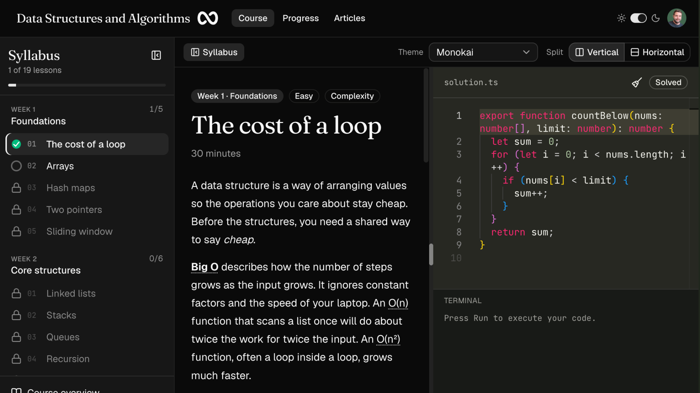

# Data Structures and Algorithms



A free, four-week course in data structures and algorithms, taught by writing TypeScript. Each lesson is short enough to finish in one sitting. You read the idea, then work through two short exercises and submit each one against tests. Every exercise has to pass before the lesson is done and the next one opens. After a failed attempt you can open a written solution, or skip the lesson without points and come back later. Audit mode, chosen during a short introduction and kept on the account, opens any lesson without waiting for the ones before it.

The live course is at [datastructuresandalgorithms.com](https://datastructuresandalgorithms.com). Creating an account, the lessons, the editor, the tests, the articles, and saved progress do not cost anything. There is no trial and no paid tier.

It is for people who already write TypeScript and want the structures and algorithms used in interviews and production code, without a semester of theory first. The coding desk is meant for a laptop or desktop.

## How a lesson works

The desk opens the lesson and a TypeScript editor side by side. You can switch that split to horizontal when you want the editor underneath. The starter function is already in the editor, and type checking runs as you type. Choose an editor theme, run the code in the terminal, then submit.

Public examples show the shape of the answer. Hidden tests check the cases that are easy to forget. The runner compiles the submission with Sucrase and executes it in `node:vm` with a ten-second timeout. `require`, imports, `process`, `eval`, and the `Function` constructor are blocked. That is enough for these exercises. It is not a hardened sandbox for arbitrary untrusted programs.

Passing every exercise marks the lesson done. A skip does not. Your draft and your passing solution stay on the account, so the editor is yours when you come back. The progress page shows lessons completed, pass rate, skipped lessons, and the topics that still have an attempt which has not passed.

## Syllabus

Thirty-eight short lessons across four weeks. Each idea is a lesson and then a slightly harder follow-up, and each of those lessons has two exercises. The table lists the first lesson of each pair. The follow-up sits immediately after it in the course.

| Week | Lesson | First exercise |
| --- | --- | --- |
| 1. Foundations | The cost of a loop | Count values below a limit |
| | Arrays | Rotate left |
| | Hash maps | Two sum |
| | Two pointers | Squares of a sorted array |
| | Sliding window | Maximum window sum |
| 2. Core structures | Linked lists | Reverse a linked list |
| | Stacks | Balanced brackets |
| | Queues | Window sums |
| | Recursion | Flatten nested numbers |
| | Binary search | Binary search |
| | Merge sort | Merge sort |
| 3. Trees and graphs | Trees | Maximum depth |
| | Binary search trees | Search a binary search tree |
| | Heaps | Kth largest |
| | Graphs | Shortest path |
| 4. Patterns | Greedy choices | Non-overlapping intervals |
| | Backtracking | Subsets |
| | Dynamic programming | Climbing stairs |
| | Tries | Trie lookup |

Week one is cost, arrays, hash maps, and the two scanning patterns the rest of the month reuses. Week two builds the structures interviews expect, plus a sort you can explain out loud. Week three walks hierarchical data, keeps a priority queue, and searches a graph. Week four finishes with the patterns that turn a hard problem into a smaller one: greedy choices, backtracking, dynamic programming, and tries.

Lesson prose, starter code, and tests live in `apps/api/src/content/`. The API upserts that course into Postgres on startup.

## Articles

The articles are longer explainers for the terms the lessons use. Each one answers a specific question, with a diagram, the cost, and a worked example from the course. They are grouped under cost, arrays, hash maps, linear structures, search and sort, trees and graphs, and patterns. Diagrams are Mermaid, rendered in the page.

Articles are content in the web app, not rows in the database. They live in `apps/web/lib/articles/`.

## Repository

- `apps/web` is the Next.js app: the course desk, articles, account pages, and progress. Deploy this on Vercel. How it is built is in [apps/web/README.md](apps/web/README.md).
- `apps/api` is an Express server with a GraphQL endpoint. Domain code is written with Effect. How it is built is in [apps/api/README.md](apps/api/README.md).
- Postgres holds users, sessions, OAuth identities, the course, and submissions.

Running both apps, and shipping them, is described in the two sections below.

## Local development

Copy the env files, put a real `POSTGRES_PASSWORD` in `.env`, and start Postgres:

```bash
cp .env.example .env
cp apps/web/.env.example apps/web/.env.local
npm run dev:db
```

`.env` is the only place secrets live. The Docker files do not contain them. `docker compose` overrides `POSTGRES_HOST` to `db` for the API container. For the API running on your machine, leave `POSTGRES_HOST=localhost`. `POSTGRES_PORT` is the port Postgres listens on inside the container. `POSTGRES_PUBLISH_PORT` and `API_PUBLISH_PORT` are the ports published on your machine, `5432` and `4000` by default, bound to `127.0.0.1`.

```bash
npm run dev:api
npm run dev:web
```

`npm run dev:docker` builds and runs the API and Postgres together. `npm run dev:docker:detach` does the same in the background. `npm run dev:logs` follows the container logs, and `npm run dev:down` stops them.

The app is at [http://localhost:3000](http://localhost:3000). GraphQL, including GraphiQL, is at [http://localhost:4000/graphql](http://localhost:4000/graphql). `GET /health` returns `{ "ok": true }`.

On startup the API runs `prepareDatabase`. It creates any missing tables, applies additive column changes, and upserts the course. A new lesson or column in that list is applied the next time the process boots. It does not drop columns or rewrite submitted code.

Google and GitHub appear on sign-in and sign-up once both the client id and secret for that provider are set. Set `API_ORIGIN` to the URL the browser uses for the API, then set those variables in `.env`.

- Google redirect URI: `{API_ORIGIN}/auth/google/callback`
- GitHub callback URL: `{API_ORIGIN}/auth/github/callback`

Google needs the `openid`, `email`, and `profile` scopes. GitHub needs `read:user` and `user:email`. A verified email from either provider signs into the account that already uses that address, including an email-and-password account. The provider's own user id stays attached to that account if the address later changes. An unverified address is not linked. Password reset email is sent through Resend when `RESEND_API_KEY` is set.

`npm run typecheck` checks both apps. API tests live next to the domain code:

```bash
npm test --prefix apps/api
```

## Deploy

Pushes to `main` deploy the two apps separately. This section is the system procedure. Project settings for Vercel are in [apps/web/README.md](apps/web/README.md). The server environment, Nginx site, and Compose ports are in [apps/api/README.md](apps/api/README.md).

**Frontend.** The Vercel project `dsa` is connected to this GitHub repository. Its root directory is `apps/web`, the production branch is `main`, and `NEXT_PUBLIC_GRAPHQL_URL` is `https://api.datastructuresandalgorithms.com/graphql`.

1. A push to `main` that changes `apps/web` builds production.
2. `deploy/vercel-ignore.sh` exits 0 to skip the build when that directory did not change, and 1 to build. The first deployment of a branch always builds.
3. Production is served at [https://datastructuresandalgorithms.com](https://datastructuresandalgorithms.com). `www` redirects there.

**API and database.** `.github/workflows/deploy-api.yml` runs on a push to `main` that changes `apps/api`, the Compose files, `deploy/`, or the workflow itself. It can also be started by hand.

1. The workflow SSHes to the VPS, clones or updates `/var/www/dsa`, and checks out `origin/main`.
2. `deploy/vps.sh` refuses to continue when `/var/www/dsa/.env` is missing, then runs `docker compose` with `docker-compose.yml` and `docker-compose.prod.yml`.
3. Postgres is published on `127.0.0.1:5437` and the API on `127.0.0.1:4002`, so they do not collide with the other stacks on that machine. `docker-compose.yml` alone is the local file. Leave the production ports off your machine.
4. Nginx at `api.datastructuresandalgorithms.com` terminates TLS and proxies to that API port. The site config is `deploy/nginx/api.datastructuresandalgorithms.com`.
5. The new API container applies schema and course content changes on startup.

The API only accepts the browser origins listed in `WEB_ORIGIN`. The production site origins are already listed. A Vercel preview URL is not, until that origin is added on the server.

## Contributing

Contributions are welcome. The course is open so that lessons, exercises, articles, and the desk around them can get better in public. A clear bug report is as useful as a patch. If you are unsure whether a change fits, open an issue before a large pull request.

Good places to start:

- **Lessons and exercises.** Prose, starter code, and tests are in `apps/api/src/content/week1.ts` through `week4.ts`, with shorter readings, extra exercises, and follow-up lessons applied in `expand.ts`. A lesson has more than one exercise. Include public tests that show the shape of the answer, and hidden tests for the empty, boundary, and awkward cases. Name the function the runner should call in `functionName`. Keep an existing lesson id when you extend it, and add a new id for a later step.
- **Articles.** Add an explainer with `defineArticle` in the matching file under `apps/web/lib/articles/`, then export it from that file's list. `apps/web/lib/articles/index.ts` already gathers those lists. One question per article, with the cost and a worked example.
- **The desk.** Editor, split layout, syllabus, progress, and account screens live in `apps/web`.
- **The runner and the domain.** Submission, scoring, auth, and insights live in `apps/api/src/domain/`.

Learner-facing copy uses British spelling: *organise*, *behaviour*, *practise* (the verb), *towards*, *labelled*. Keep the voice plain. Say what the operation costs and what it trades away.

In TypeScript, prefer a named type over `any` and over a type assertion. Return early instead of nesting conditions. Use curly braces for every `if` and `switch` case. Prefer `??` over `||` when you mean a missing value. Run `npm run typecheck` before you open a pull request, and `npm test --prefix apps/api` when you touch the runner, mail, or OAuth plan.

Fork the repository, branch from `main`, and open a pull request that says what changed and why. Small, focused changes are easier to review than a rewrite of a week.
