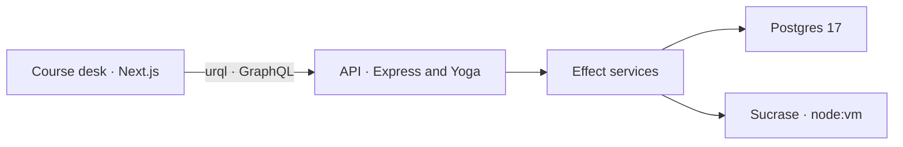

# Data Structures and Algorithms


A free four-week course in the structures and algorithms behind everyday TypeScript. Each lesson is short enough to finish in one sitting: read the idea, write the function, and submit it against tests.

The live course is [datastructuresandalgorithms.com](https://datastructuresandalgorithms.com). The account, the lessons, the editor, the tests, the articles, and saved progress are free.

It is for people who already write TypeScript and want the toolkit used in interviews and production code, without a semester of theory first. The coding desk is built for a laptop or desktop.

| | |
| --- | --- |
| Lessons | 38, taken in order: one idea, then a harder follow-up |
| Exercises | 84, each with public examples and hidden tests |
| Articles | 64 explainers, shipped as TypeScript in the web app |
| Language | TypeScript, in the browser, type-checked as you type |

## How a lesson works

The desk opens the reading and a TypeScript editor side by side. A horizontal split puts the editor underneath when you want more room for the code.

1. The starter function is already in the buffer. Type checking runs as you type.
2. Public examples show the shape of the answer.
3. Run the function in the terminal, then submit.
4. Hidden tests cover the empty, boundary, and awkward cases.
5. Passing every exercise marks the lesson done and opens the next one.

After a failed attempt you can open a written solution, or skip the lesson and come back later.

A skip is stored on its own. It opens the next lesson and leaves the exercises unsolved, so it carries no points.

Audit mode, chosen during a short introduction and kept on the account, opens every lesson at once.

Your draft and your passing solution stay on the account. The editor is yours when you return.

The progress page shows lessons completed, pass rate, skipped lessons, and the topics that still have an attempt waiting on a pass.

## Architecture

Two processes and one database. The browser never talks to Postgres.



| Piece | What it is |
| --- | --- |
| Web | Next.js 16, React, urql, Monaco, Tailwind. Renders the desk, articles, and account pages. |
| API | Node 24, Express, GraphQL Yoga, Effect. Owns accounts, the catalogue, submissions, and the runner. |
| Data | Postgres 17. Users, sessions, OAuth, the course, drafts, and submissions. |
| Runner | Sucrase compiles the submission. `node:vm` executes it. |

A lesson page loads `lesson(slug)`. urql sends the session as `Authorization: Bearer`.

Resolvers stay thin: they call an Effect service, and a tagged domain error becomes a GraphQL message the learner can act on.

### Course content

Lesson prose, starter code, and tests live in `apps/api/src/content/`.

`expandCourse` keeps every original lesson id, swaps in the shorter reading, adds the extra exercises, and inserts one follow-up lesson after each.

On startup `prepareDatabase` creates any missing tables, applies additive columns, and upserts modules, lessons, and problems.

Submitted code and drafts are left as they are. Removing a lesson from the seed leaves its row in place.

Articles take a different path. They are TypeScript modules in `apps/web/lib/articles/`, bundled with the Next.js app, and never written to Postgres.

Lesson markdown can include Mermaid diagrams and `visualization` fences. A fence is strict JSON for an array, a linked list, or a graph, and the desk renders it inline.

### The runner

`apps/api/src/domain/runner.ts` compiles with Sucrase and runs the result in `node:vm` for at most ten seconds.

`require`, imports, `process`, `globalThis`, `eval`, and the `Function` constructor are rejected before the script starts.

A problem can also list `disallow` snippets, which is how a lesson can refuse a nested loop when the point of the exercise is a single pass.

Tests compare with `exact`, or with `set` when order does not matter.

Public tests are the examples beside the prompt. Hidden tests still run.

The learner sees the name, the expected value, and the received value for each result.

That boundary is sized for these exercises: a short timeout and a denylist around `node:vm`.

### Accounts

Passwords are stored with scrypt. A password is at least 8 characters.

Sign-in creates a session that lasts 30 days. The database stores the SHA-256 of the bearer token, so a dump of `sessions` does not contain a usable credential.

Password-reset and email-verification tokens are stored the same way.

An email-and-password sign-up sends a verification link. The course opens once that link is used.

Google and GitHub appear once both the client id and the secret for that provider are set.

A verified address from either provider signs into the account that already uses it, including an email-and-password account.

The provider's own user id stays attached if the address later changes.

The API links a provider only when that provider has verified the email.

OAuth keeps a short-lived state, including the PKCE verifier, then exchanges the provider code.

The callback redirects to the web app with a one-time code. `redeemOAuthCode` turns that code into a session and accepts it once.

### What Postgres holds

| Table | Holds |
| --- | --- |
| `users` | Profile, scrypt hash, audit mode, onboarding, `email_verified_at` |
| `sessions` | SHA-256 of the bearer token, and when it expires |
| `oauth_identities` | Google or GitHub user id, bound to one account |
| `oauth_states`, `oauth_exchanges` | PKCE state, then the one-time code the browser redeems |
| `email_verifications`, `password_resets` | Hashed, expiring, single-use tokens |
| `modules`, `lessons`, `problems` | The course, upserted from TypeScript on boot |
| `drafts`, `submissions`, `lesson_skips` | In-progress code, test runs, and skips |

### GraphQL, in brief

Queries: `oauthProviders`, `me`, `modules`, `lesson`, `analytics`, `adminOverview`.

Mutations cover sign-up, sign-in, email verification, OAuth redemption, profile and password changes, drafts (`saveProgress`), `runCode`, `submitSolution`, and `skipLesson`.

`runSnippet` is public. TypeScript fences in the reading, the articles, and the written solutions call it.

The exercise terminal uses `runCode`, which requires a session.

The field list and the service map are in [apps/api/README.md](apps/api/README.md).

## Syllabus

Thirty-eight lessons across four weeks. Most lessons have two exercises.

Sliding window, trees, binary search trees, heaps, two recursive calls, and connected components have three. Two pointers has four.

The table lists the first lesson of each pair. The follow-up sits immediately after it.

| Week | Lesson | First exercise |
| --- | --- | --- |
| 1. Foundations | Time complexity and Big O | Count values below a limit |
| | Arrays | Rotate left |
| | Hash maps | Two sum |
| | Two pointers | Squares of a sorted array |
| | Sliding window | Maximum window sum |
| 2. Core structures | Linked lists | Reverse a linked list |
| | Stacks | Balanced brackets |
| | Queues | Window sums |
| | Recursion | Flatten nested numbers |
| | Binary search | Binary search |
| | Sorting with merge sort | Merge sort |
| 3. Trees and graphs | Trees | Maximum depth |
| | Binary search trees | Search a binary search tree |
| | Heaps | Kth largest |
| | Graphs and breadth-first search | Shortest path |
| 4. Patterns | Greedy algorithms | Non-overlapping intervals |
| | Backtracking | Subsets |
| | Dynamic programming | Climbing stairs |
| | Tries | Trie lookup |

Week one is cost, arrays, hash maps, and the two scanning patterns the rest of the month reuses.

Week two builds the structures interviews expect, plus a sort you can explain out loud.

Week three walks hierarchical data, keeps a priority queue, and searches a graph.

Week four finishes with the patterns that turn a hard problem into a smaller one: greedy algorithms, backtracking, dynamic programming, and tries.

## Articles

The articles are longer explainers for the terms the lessons use. Each one answers a specific question, with a diagram, the cost, and a worked example from the course.

They are grouped under cost, arrays, hash maps, linear structures, search and sort, trees and graphs, and patterns.

Diagrams are Mermaid, rendered in the page. A TypeScript fence can be run.

Suggested reading at the foot of a lesson points at the articles for that lesson's keywords.

## Repository

| Path | Role |
| --- | --- |
| [`apps/web`](apps/web/README.md) | Next.js app: the course desk, articles, account pages, and progress. Deployed on Vercel. |
| [`apps/api`](apps/api/README.md) | Express and GraphQL. Domain code is Effect. Deployed on a VPS with Postgres. |
| `deploy/` | The API workflow's remote script, and the Nginx site for the API host. |

The root `package.json` is a thin runner. It starts each app with `npm --prefix`.

It is a pair of packages, with shared environment at the repository root.

## Local development

Copy the env files, put a real `POSTGRES_PASSWORD` in `.env`, and start Postgres:

```bash
cp .env.example .env
cp apps/web/.env.example apps/web/.env.local
npm run dev:db
```

`.env` is the only place secrets live. The Docker files do not contain them.

`docker compose` overrides `POSTGRES_HOST` to `db` for the API container. For the API running on your machine, leave `POSTGRES_HOST=localhost`.

`POSTGRES_PORT` is the port Postgres listens on inside the container.

`POSTGRES_PUBLISH_PORT` and `API_PUBLISH_PORT` are the ports published on your machine, `5432` and `4000` by default, bound to `127.0.0.1`.

```bash
npm run dev:api
npm run dev:web
```

| Command | What it does |
| --- | --- |
| `npm run dev:docker` | Builds and runs the API and Postgres together |
| `npm run dev:docker:detach` | Same, in the background |
| `npm run dev:logs` | Follows the container logs |
| `npm run dev:down` | Stops the stack |

The app is at [http://localhost:3000](http://localhost:3000).

GraphQL, including GraphiQL, is at [http://localhost:4000/graphql](http://localhost:4000/graphql). `GET /health` returns `{ "ok": true }`.

On startup the API runs `prepareDatabase`. A new lesson or an additive column is applied the next time the process boots.

Google and GitHub appear on sign-in and sign-up once both the client id and secret for that provider are set.

Set `API_ORIGIN` to the URL the browser uses for the API, then set those variables in `.env`.

- Google redirect URI: `{API_ORIGIN}/auth/google/callback`
- GitHub callback URL: `{API_ORIGIN}/auth/github/callback`

Google needs the `openid`, `email`, and `profile` scopes. GitHub needs `read:user` and `user:email`.

Account mail goes out through Resend when `RESEND_API_KEY` is set: the verification link, password reset, and the note that a password changed.

With the key empty, those messages are not sent.

```bash
npm run typecheck
npm test --prefix apps/api
```

`npm run typecheck` checks both apps.

API tests live next to the domain code and cover the runner, gating, mail, OAuth, email verification, and the course seed.

## Deploy

Pushes to `main` deploy the two apps separately. This section is the system procedure.

Project settings for Vercel are in [apps/web/README.md](apps/web/README.md). The server environment, Nginx site, and Compose ports are in [apps/api/README.md](apps/api/README.md).

### Frontend

The Vercel project `dsa` is connected to this GitHub repository.

Its root directory is `apps/web`, the production branch is `main`, and `NEXT_PUBLIC_GRAPHQL_URL` is `https://api.datastructuresandalgorithms.com/graphql`.

1. A push to `main` that changes `apps/web` builds production.
2. `deploy/vercel-ignore.sh` exits 0 to skip the build when that directory did not change, and 1 to build. The first deployment of a branch always builds.
3. Production is served at [https://datastructuresandalgorithms.com](https://datastructuresandalgorithms.com). `www` redirects there.

### API and database

`.github/workflows/deploy-api.yml` runs on a push to `main` that changes `apps/api`, the Compose files, `deploy/`, or the workflow itself. It can also be started by hand.

1. The workflow SSHes to the VPS, clones or updates `/var/www/dsa`, and checks out `origin/main`.
2. `deploy/vps.sh` refuses to continue when `/var/www/dsa/.env` is missing, then runs `docker compose` with `docker-compose.yml` and `docker-compose.prod.yml`.
3. Postgres is published on `127.0.0.1:5437` and the API on `127.0.0.1:4002`, so they stay clear of the other stacks on that machine.
4. Nginx at `api.datastructuresandalgorithms.com` terminates TLS and proxies to that API port. The site config is `deploy/nginx/api.datastructuresandalgorithms.com`.
5. The new API container applies schema and course content changes on startup.

`docker-compose.yml` alone is the local file. Leave the production ports off your machine.

The API accepts the browser origins listed in `WEB_ORIGIN`. The production site origins are already listed.

A Vercel preview URL needs to be added on the server before that preview can sign in.

## Contributing

Contributions are welcome. The course is open so that lessons, exercises, articles, and the desk around them can get better in public.

A clear bug report is as useful as a patch. If you are unsure whether a change fits, open an issue before a large pull request.

The full guide, including the visualization schema, is in [CONTRIBUTING.md](CONTRIBUTING.md).

Good places to start:

- **Lessons and exercises.** Prose, starter code, and tests are in `apps/api/src/content/week1.ts` through `week4.ts`.

  Shorter readings, extra exercises, and follow-up lessons are applied in `expand.ts`.

  A lesson has more than one exercise. Include public tests that show the shape of the answer, and hidden tests for the empty, boundary, and awkward cases.

  Name the function the runner should call in `functionName`. Keep an existing lesson id when you extend it, and add a new id for a later step.
- **Articles.** Add an explainer with `defineArticle` in the matching file under `apps/web/lib/articles/`, then export it from that file's list.

  `apps/web/lib/articles/index.ts` already gathers those lists. One question per article, with the cost and a worked example.
- **The desk.** Editor, split layout, syllabus, progress, and account screens live in `apps/web`.
- **The runner and the domain.** Submission, scoring, auth, and insights live in `apps/api/src/domain/`.

Learner-facing copy uses British spelling: *organise*, *behaviour*, *practise* (the verb), *towards*, *labelled*.

Keep the voice plain. Say what the operation costs and what it trades away.

In TypeScript, prefer a named type over `any` and over a type assertion.

Return early instead of nesting conditions. Use curly braces for every `if` and `switch` case. Prefer `??` over `||` when you mean a missing value.

Run `npm run typecheck` before you open a pull request, and `npm test --prefix apps/api` when you touch the runner, mail, OAuth, or the course seed.

Fork the repository, branch from `main`, and open a pull request that says what changed and why. Small, focused changes are easier to review than a rewrite of a week.
